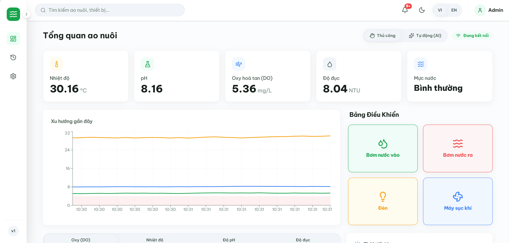
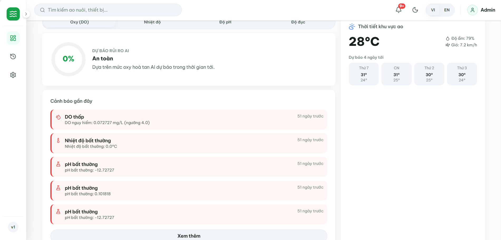
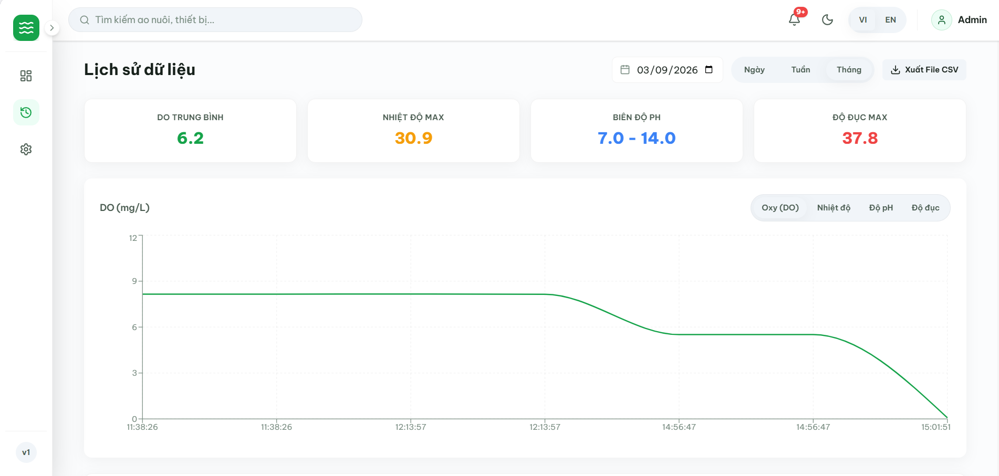
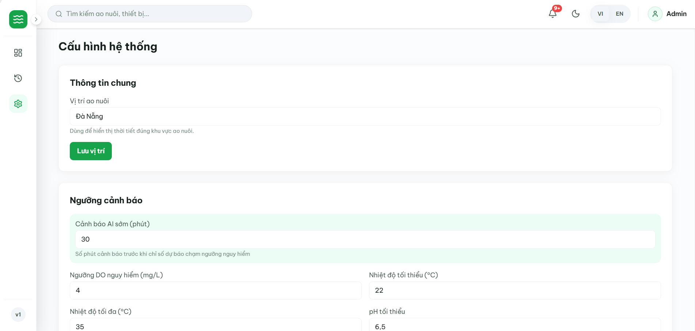

<div align="center">

  <h1>EcoShrimp - Realtime Aquaculture Dashboard & Telemetry Portal</h1>
  <h3>Cổng Thông Tin & Bảng Điều Khiển Giám Sát Ao Nuôi Tôm Thời Gian Thực</h3>

  <p>
    Giao diện điều hành thông minh thế hệ mới dành cho trang trại nuôi tôm công nghệ cao,
    tối ưu hóa hiển thị dữ liệu viễn trắc môi trường ao nuôi qua kết nối WebSocket thời gian thực,
    trực quan hóa biến thiên thông số đa chiều với Recharts, cung cấp khuyến nghị can thiệp dựa trên dự báo AI,
    trung tâm điều khiển thiết bị phụ tải rơ-le có cơ chế khóa liên động an toàn và phân hệ phân tích lịch sử kèm xuất báo cáo CSV.
  </p>

  <p>
    
    
    
    
    
    
    
  </p>

</div>

<br />

# FRONTEND WEB PORTAL & REALTIME AQUACULTURE DASHBOARD

Đây là kho lưu trữ chứa mã nguồn **Frontend Web Dashboard** của hệ thống **EcoShrimp**. Ứng dụng được nghiên cứu và phát triển dưới dạng **mô hình thử nghiệm khả thi (Proof of Concept - PoC)** theo kiến trúc **Next.js 16 App Router** hiện đại nhất kết hợp **React 19**, mang lại khả năng cập nhật giao diện mượt mà với độ trễ tối thiểu khi tiếp nhận luồng dữ liệu liên tục từ máy chủ backend qua giao thức **WebSocket**, đồng thời tích hợp hệ thống điều khiển thiết bị phụ tải, phân tích chuỗi thời gian lịch sử, xuất báo cáo CSV, quản lý cấu hình ngưỡng an toàn và hỗ trợ giao diện song ngữ (Tiếng Việt & Tiếng Anh).

> [!NOTE]
> **Hiện trạng dự án:** Hệ thống hiện đang ở giai đoạn nguyên mẫu nghiên cứu (Prototype / PoC) phục vụ đồ án kỹ thuật, chưa được triển khai trên các ao/bể nuôi tôm thương phẩm thực tế. Dữ liệu viễn trắc hiển thị trên giao diện hiện được kết nối từ mô hình phần cứng thử nghiệm (bo mạch ESP32 sử dụng núm vặn biến trở vật lý) hoặc kịch bản giả lập phần mềm từ Backend (`scripts/simulate_sensors.py`). Các gợi ý từ AI đóng vai trò khuyến nghị can thiệp tham khảo (Advisory Mode), hỗ trợ người vận hành quan sát trực quan và chủ động điều phối thiết bị.

---

## Mục lục

- [1. Công nghệ & Thư viện Cốt lõi](#1-công-nghệ--thư-viện-cốt-lõi)
  - [Khung Giao diện & Nền tảng Ứng dụng](#khung-giao-diện--nền-tảng-ứng-dụng)
  - [Thiết kế Giao diện, Biểu tượng & Trình bày](#thiết-kế-giao-diện-biểu-tượng--trình-bày)
  - [Trực quan hóa Dữ liệu & Đồ thị Vi sai](#trực-quan-hóa-dữ-liệu--đồ-thị-vi-sai)
  - [Kết nối Thời gian thực & Quản lý Truyền thông](#kết-nối-thời-gian-thực--quản-lý-truyền-thông)
- [2. Tính năng Giao diện & Kiến trúc Bảng Điều khiển](#2-tính-năng-giao-diện--kiến-trúc-bảng-điều-khiển)
  - [2.1. Bảng Đo lường Chỉ số Môi trường Tức thời (`/`)](#21-bảng-đo-lường-chỉ-số-môi-trường-tức-thời-)
  - [2.2. Khuyến nghị Can thiệp Dựa trên Dự báo AI & Thước đo Rủi ro](#22-khuyến-nghị-can-thiệp-dựa-trên-dự-báo-ai--thước-đo-rủi-ro)
  - [2.3. Bảng Điều khiển Thiết bị Phụ tải & Khóa Liên động An toàn](#23-bảng-điều-khiển-thiết-bị-phụ-tải--khóa-liên-động-an-toàn)
  - [2.4. Phân hệ Phân tích Lịch sử & Xuất Báo cáo CSV (`/history`)](#24-phân-hệ-phân-tích-lịch-sử--xuất-báo-cáo-csv-history)
  - [2.5. Trung tâm Cấu hình Tham số Hệ thống & Lập lịch (`/settings`)](#25-trung-tâm-cấu-hình-tham-số-hệ-thống--lập-lịch-settings)
  - [2.6. Nhật ký Cảnh báo, Đa Chế độ Sáng / Tối & Song ngữ (VI/EN)](#26-nhật-ký-cảnh-báo-đa-chế-độ-sáng--tối--song-ngữ-vien)
- [3. Demo Giao diện Người dùng](#3-demo-giao-diện-người-dùng)
- [4. Hướng dẫn Cài đặt & Khởi chạy](#4-hướng-dẫn-cài-đặt--khởi-chạy)
- [5. Cấu trúc Thư mục Dự án](#5-cấu-trúc-thư-mục-dự-án)
- [6. Kết nối Backend API & WebSocket Service](#6-kết-nối-backend-api--websocket-service)
- [7. Thông tin Bản vá Bảo mật (Security Advisory)](#7-thông-tin-bản-vá-bảo-mật-security-advisory)
- [8. Tác giả](#8-tác-giả)

---

## 1. Công nghệ & Thư viện Cốt lõi

Hệ thống giao diện ứng dụng các phiên bản công nghệ mới nhất trong hệ sinh thái React:

### Khung Giao diện & Nền tảng Ứng dụng

| Công nghệ / Thư viện | Phiên bản | Vai trò Kỹ thuật |
| :--- | :--- | :--- |
| **[Next.js](https://nextjs.org/)** | `16.4.3` *(Patched)* | Khung ứng dụng React App Router, Server Components và Turbopack đã khắc phục các lỗ hổng bảo mật nghiêm trọng |
| **[React](https://react.dev/)** | `19.2.8` | Thư viện UI cốt lõi phiên bản React 19 tối ưu hóa hiệu năng render cây thành phần |
| **[React DOM](https://react.dev/)** | `19.2.8` | Điểm gắn kết DOM cho các thành phần React |
| **[TypeScript](https://www.typescriptlang.org/)** | `^5` | Đảm bảo tính an toàn kiểu dữ liệu tĩnh nghiêm ngặt trên toàn bộ dự án |

---

### Thiết kế Giao diện, Biểu tượng & Trình bày

| Công nghệ / Thư viện | Phiên bản | Vai trò Kỹ thuật |
| :--- | :--- | :--- |
| **[Tailwind CSS](https://tailwindcss.com/)** | `^4` | Framework CSS Utility-first thế hệ v4 với cơ chế biên dịch CSS-first qua `@tailwindcss/postcss` |
| **[Lucide React](https://lucide.dev/)** | `^1.33.0` | Bộ biểu tượng SVG sắc nét, đồng bộ cho các trạng thái cảm biến và thiết bị phụ tải |
| **[ESLint](https://eslint.org/)** | `^9` | Công cụ phân tích cú pháp tĩnh đảm bảo chuẩn mực mã nguồn |
| **[eslint-config-next](https://nextjs.org/docs/app/api-reference/config/eslint)** | `16.4.3` | Cấu hình kiểm tra chuẩn hóa mã nguồn chuyên biệt cho Next.js 16 |
| **[Font Be Vietnam Pro](https://fonts.google.com/specimen/Be+Vietnam+Pro)** | `next/font/google` | Phông chữ tiếng Việt hiện đại, tối ưu hóa hiển thị và tải trang |

---

### Trực quan hóa Dữ liệu & Đồ thị Vi sai

| Công nghệ / Thư viện | Phiên bản | Vai trò Kỹ thuật |
| :--- | :--- | :--- |
| **[Recharts](https://recharts.org/)** | `^3.10.1` | Thư viện biểu đồ tương tác: Biểu đồ đường chuỗi thời gian, đồ thị vi sai và các dải tô màu vùng nguy hiểm (`ReferenceArea`) |
| **[Open-Meteo API](https://open-meteo.com/)** | `REST Client` | Cung cấp dữ liệu dự báo thời tiết 4 ngày dựa trên tọa độ địa lý trang trại |
| **[Risk Gauge & Trend Calculator](https://github.com/thanhthuan04/ecoshrimp-web)** | `Module nội bộ` | Thành phần đo lường rủi ro phi tuyến và tính toán tỷ lệ phần trăm xu hướng so với ngày hôm trước |

---

### Kết nối Thời gian thực & Quản lý Truyền thông

| Công nghệ / Thư viện | Phiên bản | Vai trò Kỹ thuật |
| :--- | :--- | :--- |
| **[WebSocket Client Hook](https://developer.mozilla.org/en-US/docs/Web/API/WebSocket)** | `useWebSocket` | Quản lý kết nối hai chiều thời gian thực, có cơ chế tự động tái kết nối (Reconnect Interval 3000ms) |
| **[Fetch API Client](https://developer.mozilla.org/en-US/docs/Web/API/Fetch_API)** | `apiClient` | Wrapper gọi API có đính kèm tiêu đề xác thực `X-API-Key` và tự động phân giải mã lỗi HTTP |
| **[Theme & Language Providers](https://react.dev/reference/react/createContext)** | `Context API` | Quản lý trạng thái đa ngôn ngữ tức thì và chuyển đổi giao diện Sáng / Tối có lưu LocalStorage |

---

## 2. Tính năng Giao diện & Kiến trúc Bảng Điều khiển

Ứng dụng phân chia kiến trúc giao diện theo các phân hệ chức năng chuyên biệt:

### 2.1. Bảng Đo lường Chỉ số Môi trường Tức thời (`/`)
* **Hộp Thông tin Chỉ số (RealtimeCard):**
  Hiển thị 4 tham số then chốt của ao nuôi tôm:
  * **Oxy hòa tan (DO):** Định lượng theo $mg/L$, đi kèm huy hiệu trạng thái (Bình thường / Thấp / Nguy hiểm).
  * **Nhiệt độ (Temperature):** Đo đạc theo $\text{°C}$, cảnh báo khi nhiệt độ giảm sâu hoặc tăng cao quá ngưỡng.
  * **Độ pH:** Kiểm soát độ cân bằng axit-kiềm của môi trường ao.
  * **Độ đục (Turbidity):** Đo lường hàm lượng phù sa và cặn lơ lửng ($NTU$).
* **Chỉ báo Xu hướng Biến thiên (Trend Percent):**
  Tự động so sánh giá trị hiện hành với mức trung bình 24 giờ trước đó để hiển thị xu hướng tăng/giảm phần trăm.
* **Đồ thị Thời gian thực (RealtimeChart):**
  Hiển thị 30 điểm đo mới nhất kèm vùng tô màu nguy hiểm oxy thấp (`ReferenceArea`) giúp phát hiện ngay các bất thường cục bộ.
* **Thẻ Mực Nước & Thời Tiết (WaterLevelCard & WeatherWidget):**
  Hiển thị trạng thái an toàn mực nước và thông tin nhiệt độ, độ ẩm khí quyển 4 ngày quanh khu vực trang trại từ Open-Meteo.

---

### 2.2. Khuyến nghị Can thiệp Dựa trên Dự báo AI & Thước đo Rủi ro
* **Đo lường Mức độ Rủi ro (RiskGauge):**
  Trực quan hóa mức độ rủi ro dựa trên độ sai lệch giữa thông số dự báo tương lai (từ mô hình XGBoost của Backend) so với khoảng giá trị an toàn.
* **Khuyến nghị Hành động Tức thời (RecommendationCard):**
  Tự động đề xuất thiết bị cần kích hoạt khi phát hiện nguy cơ bất thường trong tương lai:
  * Gợi ý bật máy sục khí (quạt oxy) khi DO có nguy cơ giảm dưới ngưỡng nguy hiểm.
  * Gợi ý bật đèn sưởi khi nước có xu hướng lạnh dưới ngưỡng tối thiểu.
  * Gợi ý điều phối bơm cấp/thoát khi pH hoặc độ đục có xu hướng trôi khỏi vùng chuẩn.
* **Kích hoạt Nhanh 1 Chạm:**
  Cung cấp nút lệnh thực thi trực tiếp khuyến nghị mà không cần điều hướng sang trang khác.
* **Cơ Chế Khuyến Nghị Tham Khảo (Advisory Mode):**
  Các đề xuất từ mô hình AI đóng vai trò hệ số trợ giúp quyết định (Decision Support System) hỗ trợ người vận hành nhận biết sớm nguy cơ, chưa thay thế hoàn toàn việc kiểm soát cân bằng sinh thái ao nuôi tự động trong thực tế.

---

### 2.3. Bảng Điều khiển Thiết bị Phụ tải & Khóa Liên động An toàn
* **Chuyển Chế độ Vận hành (SystemModeToggle):**
  Chuyển đổi linh hoạt giữa chế độ **Tự động (Auto)** và chế độ **Thủ công (Manual)**.
* **Bảng Rơ-le Thiết bị (DeviceControl):**
  Điều khiển bật/tắt độc lập 4 thiết bị phụ tải:
  * Máy sục khí oxy (`aerator`).
  * Máy bơm cấp nước vào ao (`pump_in`).
  * Máy bơm thoát nước ra ngoài (`pump_out`).
  * Đèn sưởi ổn định nhiệt độ (`light`).
* **Khóa Liên động An toàn Phần cứng (Safety Interlock):**
  Vô hiệu hóa tự động và ngăn chặn hoàn toàn việc bật bơm thoát (`pump_out`) khi cảm biến báo mực nước đang ở mức thấp, bảo vệ an toàn cho đàn tôm.

---

### 2.4. Phân hệ Phân tích Lịch sử & Xuất Báo cáo CSV (`/history`)
* **Bộ Lọc Thời Gian Đa Chiều:**
  Hỗ trợ chọn ngày mốc và lọc dữ liệu theo phạm vi: Ngày (`day`), Tuần (`week`), Tháng (`month`).
* **Thống Kê Tóm Tắt (StatCards):**
  Tính toán tức thời các giá trị Cao nhất (Max), Thấp nhất (Min) và Trung bình (Avg) cho từng chỉ số lựa chọn.
* **Đồ Thị Xu Hướng Dài Hạn:**
  Biểu đồ Recharts `LineChart` phản hồi mượt mà theo từng chỉ số với đường biểu diễn màu sắc chuyên biệt.
* **Bảng Dữ Liệu Chi Tiết (DataTable):**
  Trình bày danh sách điểm đo lịch sử có phân trang rõ ràng.
* **Xuất Báo Cáo CSV (Export to CSV):**
  Hỗ trợ tải xuống tệp dữ liệu định dạng chuẩn UTF-8 BOM kèm siêu dữ liệu vị trí trang trại, phục vụ công tác kiểm định và lưu trữ nội bộ.

---

### 2.5. Trung tâm Cấu hình Tham số Hệ thống & Lập lịch (`/settings`)
* **Thông Tin Chung Trang Trại (GeneralForm):**
  Cấu hình tọa độ địa lý (Vĩ độ / Kinh độ) phục vụ đồng bộ dữ liệu thời tiết thực tế.
* **Cấu Hình Ngưỡng An Toàn (ThresholdForm):**
  Thiết lập ngưỡng cực tiểu và cực đại cho từng tham số (DO, Nhiệt độ, pH, Độ đục) và thời gian cảnh báo sớm AI (15 - 60 phút).
* **Quyền Tự Động Hóa Thiết Bị (AutomationForm):**
  Bật hoặc tắt độc lập quyền tự động kích hoạt cho từng rơ-le phụ tải khi AI phát hiện nguy cơ.
* **Lập Lịch Hẹn Giờ (TimerForm):**
  Cấu hình khung giờ bật/tắt cố định trong ngày cho 4 thiết bị.
* **Cơ Chế Dự Phòng Ngoại Tuyến (Offline Fallback):**
  Tự động sử dụng cấu hình mặc định an toàn (`DEFAULT_SETTINGS`) và hiển thị cảnh báo nếu máy chủ chưa sẵn sàng.

---

### 2.6. Nhật ký Cảnh báo, Đa Chế độ Sáng / Tối & Song ngữ (VI/EN)
* **Trung tâm Cảnh báo (AlertCenter):**
  Theo dõi danh sách các cảnh báo vi phạm ngưỡng và cảnh báo sớm AI theo dòng thời gian (Time-ago format), hỗ trợ xem thêm dữ liệu.
* **Hệ thống Thông báo Tức thì (Toast Notifications):**
  Bật thông báo nổi ngay trên màn hình khi phát hiện thông số bất thường hoặc thao tác điều khiển bị khóa an toàn.
* **Chế Độ Giao Diện Sáng / Tối (ThemeSwitcher):**
  Hỗ trợ Light Mode và Dark Mode hoàn chỉnh, lưu trữ tùy chọn vào LocalStorage và có script chống hiện tượng nhấp nháy giao diện khi tải trang.
* **Hỗ trợ Song ngữ Toàn diện (LanguageSwitcher):**
  Chuyển đổi tức thì giữa Tiếng Việt và Tiếng Anh (`LanguageProvider`) cho toàn bộ nhãn, thông báo và biểu đồ.

---

## 3. Demo Giao diện Người dùng

### 1. Bảng Điều Khiển Viễn Trắc Thời Gian Thực (Realtime Telemetry Dashboard)


### 2. Thước Đo Rủi Ro & Khuyến Nghị Can Thiệp AI (AI Risk Gauge & Recommendations)


### 3. Phân Hệ Phân Tích Lịch Sử & Xuất Báo Cáo CSV (Historical Analytics & Export)


### 4. Trung Tâm Cấu Hình Tham Số & Lập Lịch Rơ-le (System Settings & Timers)


---

## 4. Hướng dẫn Cài đặt & Khởi chạy

### Yêu cầu Hệ thống
* **Node.js:** Phiên bản `>= 20.0.0` (Khuyến nghị **Node.js 20.x** hoặc **22.x LTS**).
* **Trình quản lý gói:** `npm`, `yarn`, `pnpm` hoặc `bun`.
* **Backend Service:** Máy chủ **EcoShrimp Backend** đang chạy tại cổng `8000`.

### Quy trình Cài đặt

```bash
# 1. Tải mã nguồn Frontend về máy cục bộ
git clone https://github.com/thanhthuan04/ecoshrimp-web.git
cd ecoshrimp-web

# 2. Cài đặt toàn bộ thư viện phụ thuộc
npm install
```

### Cấu hình Biến Môi trường (.env.local)

Tạo tệp `.env.local` tại thư mục gốc của dự án:

```env
# Địa chỉ HTTP của Backend API
NEXT_PUBLIC_API_URL=http://localhost:8000

# Địa chỉ WebSocket truyền phát dữ liệu thời gian thực
NEXT_PUBLIC_WS_URL=ws://localhost:8000/ws/data

# Khóa bí mật API đồng bộ với Backend
NEXT_PUBLIC_API_KEY=Ecoshrimp@2026
```

### Các Lệnh Thực thi

```bash
# 1. Khởi chạy môi trường phát triển (Dev Server tại port 3000 với Turbopack)
npm run dev

# 2. Biên dịch bản phát hành sản phẩm (Production Build)
npm run build

# 3. Khởi chạy bản production đã biên dịch
npm run start

# 4. Kiểm tra lỗi cú pháp và quy chuẩn mã nguồn (ESLint)
npm run lint
```

Sau khi khởi chạy thành công, truy cập giao diện trên trình duyệt tại:
```text
http://localhost:3000
```

---

## 5. Cấu trúc Thư mục Dự án

```text
ecoshrimp-web/
├── app/                           # Cấu trúc Next.js 16 App Router
│   ├── history/                   # Phân hệ phân tích chuỗi thời gian lịch sử
│   │   └── page.tsx               # Trang biểu đồ, thống kê min/max/avg và xuất CSV
│   ├── settings/                  # Phân hệ thiết lập tham số hệ thống
│   │   └── page.tsx               # Trang cấu hình vị trí, ngưỡng an toàn, tự động & timer
│   ├── favicon.ico
│   ├── globals.css                # Thiết lập bảng màu và CSS Variables Tailwind v4
│   ├── layout.tsx                 # Root Layout cấu hình Font Be Vietnam Pro và Theme/Language Providers
│   └── page.tsx                   # Trang Dashboard điều hành trung tâm thời gian thực
├── components/                    # Tầng các thành phần giao diện tái sử dụng
│   ├── control/                   # Thành phần điều khiển thiết bị
│   │   ├── DeviceControl.tsx      # Rơ-le điều khiển thiết bị có khóa liên động
│   │   └── SystemModeToggle.tsx   # Chuyển đổi chế độ Tự động / Thủ công
│   ├── dashboard/                 # Bảng điều khiển viễn trắc ao nuôi
│   │   ├── AlertCenter.tsx        # Trung tâm hiển thị lịch sử cảnh báo
│   │   ├── RealtimeCard.tsx       # Khối đo lường chỉ số cảm biến tức thời
│   │   ├── RealtimeChart.tsx      # Biểu đồ chuỗi thời gian Recharts
│   │   ├── RecommendationCard.tsx # Khuyến nghị can thiệp thông minh dựa trên AI
│   │   ├── RiskGauge.tsx          # Thước đo rủi ro trực quan
│   │   ├── StatusBadge.tsx        # Huy hiệu hiển thị trạng thái an toàn / nguy hại
│   │   ├── Toast.tsx              # Hộp thông báo nổi thông minh
│   │   ├── WaterLevelCard.tsx     # Trực quan hóa trạng thái mực nước
│   │   └── WeatherWidget.tsx      # Tiện ích thời tiết môi trường ao nuôi từ Open-Meteo
│   ├── history/                   # Thành phần phục vụ phân tích lịch sử
│   │   ├── ChartTabs.tsx          # Bộ chọn phạm vi ngày / tuần / tháng
│   │   ├── DataTable.tsx          # Bảng dữ liệu điểm đo lịch sử có phân trang
│   │   ├── MetricTabs.tsx         # Bộ chọn chuyển đổi tham số xem biểu đồ
│   │   └── StatCards.tsx          # Thẻ giá trị cao nhất, thấp nhất, trung bình
│   ├── layout/                    # Bộ khung giao diện nền tảng
│   │   ├── AppShell.tsx           # Khung vỏ tích hợp Sidebar, Topbar và Content
│   │   ├── LanguageSwitcher.tsx   # Bộ chuyển đổi Tiếng Việt / Tiếng Anh
│   │   ├── Sidebar.tsx            # Menu điều hướng chính có hỗ trợ thu gọn
│   │   ├── ThemeSwitcher.tsx      # Nút chuyển đổi Light / Dark mode
│   │   └── Topbar.tsx             # Thanh điều hướng trên cùng
│   ├── settings/                  # Các biểu mẫu cấu hình hệ thống
│   │   ├── AutomationForm.tsx     # Bật / tắt tự động hóa từng thiết bị
│   │   ├── GeneralForm.tsx        # Tọa độ địa lý trang trại
│   │   ├── ThresholdForm.tsx      # Thiết lập ngưỡng an toàn và thời gian AI cảnh báo
│   │   └── TimerForm.tsx          # Thiết lập khung giờ hẹn giờ rơ-le
│   └── ui/                        # Các nguyên tử giao diện nền tảng
│       ├── Button.tsx
│       ├── Card.tsx
│       ├── Input.tsx
│       ├── Skeleton.tsx
│       └── Switch.tsx
├── hooks/                         # Các Custom Hooks xử lý logic và trạng thái
│   ├── useLanguage.tsx            # Hook điều phối ngữ cảnh ngôn ngữ (vi/en)
│   ├── useTheme.tsx               # Hook điều phối giao diện Sáng / Tối
│   ├── useToast.ts                # Hook quản lý hàng đợi thông báo Toast
│   └── useWebSocket.ts            # Hook kết nối và tự động tái kết nối WebSocket
├── lib/                           # Thư viện và hàm tiện ích
│   ├── apiClient.ts               # HTTP Client có gắn tiêu đề X-API-Key
│   ├── calcTrend.ts               # Thuật toán tính phần trăm xu hướng 24h
│   ├── defaultSettings.ts         # Giá trị cấu hình ngưỡng an toàn mặc định
│   ├── exportCsv.ts               # Tiện ích xuất dữ liệu lịch sử ra tệp CSV UTF-8 BOM
│   ├── riskCalculator.ts          # Tính toán độ đo rủi ro môi trường
│   └── i18n/
│       └── translations.ts        # Bộ từ điển song ngữ Tiếng Việt và Tiếng Anh
├── public/                        # Thư mục tài nguyên tệp tĩnh
│   ├── demo/                      # Tệp ảnh chụp màn hình minh họa giao diện hệ thống
│   └── *.svg                      # Các biểu tượng SVG tĩnh
├── types/                         # Định nghĩa kiểu dữ liệu tĩnh TypeScript
│   ├── alert.ts                   # Kiểu dữ liệu cảnh báo và danh mục cảnh báo
│   ├── history.ts                 # Kiểu dữ liệu lịch sử viễn trắc
│   ├── sensor.ts                  # Kiểu dữ liệu số liệu cảm biến và dự báo AI
│   └── settings.ts                # Kiểu dữ liệu cấu hình ngưỡng và chế độ hệ thống
├── package.json                   # Danh mục thư viện phụ thuộc đã cập nhật bảo mật
├── tsconfig.json                  # Cấu hình kiểm tra kiểu dữ liệu TypeScript
└── README.md                      # Tài liệu kỹ thuật chi tiết giao diện
```

---

## 6. Kết nối Backend API & WebSocket Service

Giao diện Frontend liên kết chặt chẽ với máy chủ **EcoShrimp Backend**:
* **Kênh truyền phát trực tiếp (WebSocket):** Tiếp nhận dữ liệu liên tục qua `ws://localhost:8000/ws/data`, tự động giải mã cấu trúc JSON và cập nhật state React tức thì mà không cần thăm dò liên tục (Polling).
* **Kênh điều khiển & cấu hình (RESTful API):** Các thao tác điều khiển rơ-le hoặc chuyển đổi chế độ gửi yêu cầu `POST /api/control` và `POST /api/control/mode` kèm tiêu đề bảo mật `X-API-Key`.
* **Cơ chế Dự phòng (Offline Fallback):** Khi mất kết nối máy chủ, giao diện tự động sử dụng cấu hình mặc định an toàn (`DEFAULT_SETTINGS`) và kích hoạt cảnh báo ngoại tuyến.

---

## 7. Thông tin Bản vá Bảo mật (Security Advisory)

Dự án đã thực hiện rà soát và nâng cấp toàn diện các thư viện phụ thuộc lên phiên bản an toàn mới nhất nhằm loại bỏ các lỗ hổng bảo mật nghiêm trọng:

* **Next.js `16.4.3` (Đã vá):** Khắc phục triệt để 2 lỗ hổng thực thi mã từ xa không xác thực (**Critical RCE** - CVSS 9.5) trong cơ chế xử lý bộ nhớ cache (`GHSA-673q-mjm6-r5xr`) và API tối ưu hóa ảnh qua tệp SVG (`CVE-2026-96889` / `GHSA-2464-fhr4-w9xw`), cùng lỗ hổng từ chối dịch vụ (**High DoS** - CVSS 8.2 - `GHSA-p3m5-59mp-jv5r`).
* **ESLint Config Next `16.4.3`:** Đồng bộ với phiên bản Next.js đã vá.
* **React `19.2.8`:** Sử dụng phiên bản ổn định nhất của hệ sinh thái React 19.

---

## 8. Tác giả

Dự án được nghiên cứu và phát triển bởi:

* **Hứa Viết Thái**  
  Email: [huavietthai299@gmail.com](mailto:huavietthai299@gmail.com) | GitHub: [https://github.com/hvt299](https://github.com/hvt299)
* **Nguyễn Thành Thuận**  
  Email: [ntthuan172@gmail.com](mailto:ntthuan172@gmail.com) | GitHub: [https://github.com/thanhthuan04](https://github.com/thanhthuan04)
